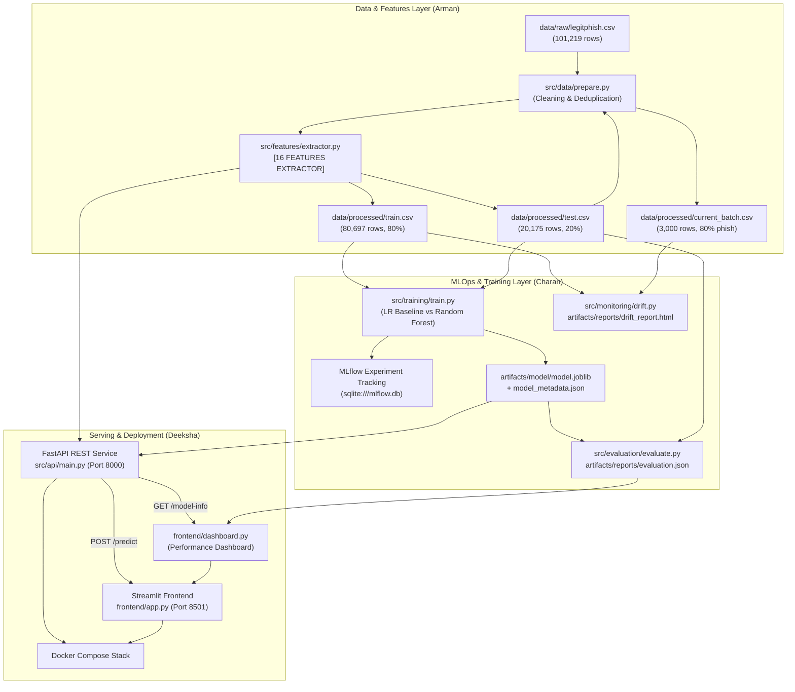
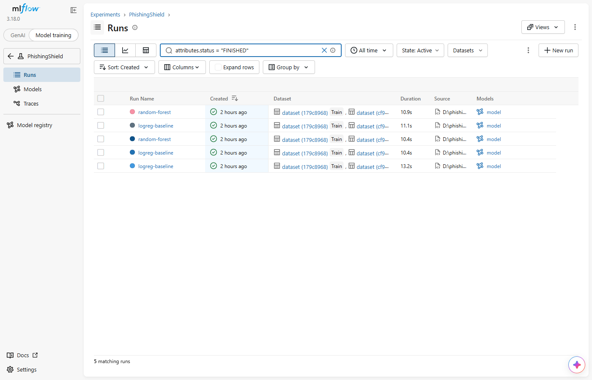
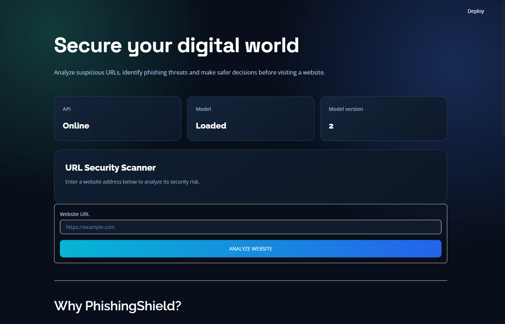
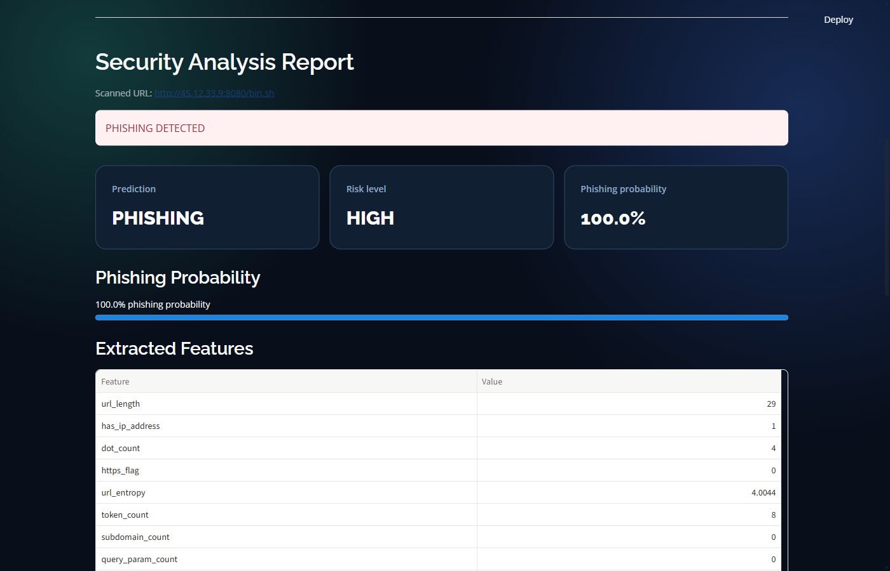
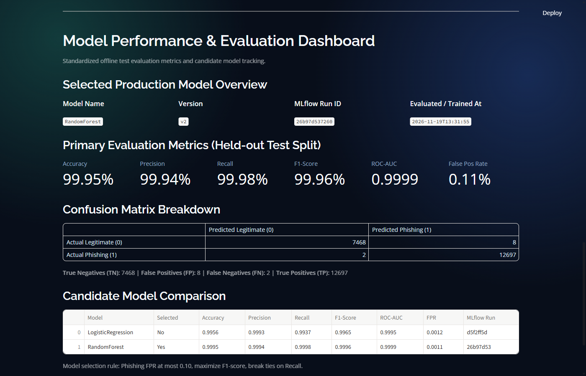
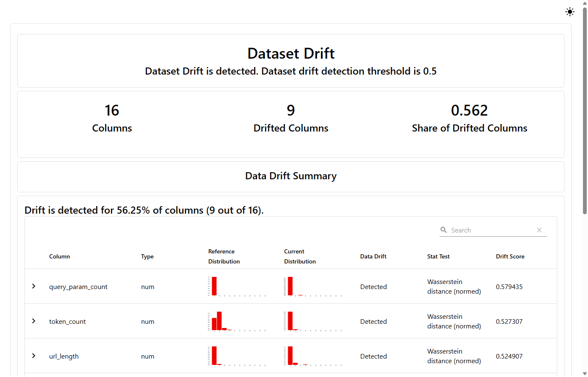

# 🛡️ PhishingShield ("PhiShark - AI Phishing Analyst")

[](https://github.com/SinghCharanjeet11/phishing_shield/actions)
[](https://www.python.org/downloads/)
[](https://opensource.org/licenses/MIT)

PhishingShield is an end-to-end, production-grade MLOps system engineered to detect phishing URLs using 16 lexical and structural features. It demonstrates the complete machine learning engineering lifecycle: dataset preparation with zero train/test leakage, reproducible model training and comparison tracked in MLflow, model serialization and versioning, REST API serving via FastAPI, an interactive Streamlit UI with an embedded performance dashboard, containerized Docker deployment, automated GitHub Actions CI, and data drift monitoring using Evidently.

---

## 📑 Table of Contents
1. [Project Overview](#project-overview)
2. [Key Features](#key-features)
3. [System Architecture](#system-architecture)
4. [Technology Stack](#technology-stack)
5. [Repository Structure](#repository-structure)
6. [Empirical Model Performance](#empirical-model-performance)
7. [Installation & Setup](#installation--setup)
   - [Windows Setup](#windows-powershell-setup)
   - [Linux / macOS Setup](#linux--macos-setup)
8. [Pipeline Commands](#pipeline-commands)
9. [Docker Deployment](#docker-deployment)
10. [Streamlit Model Performance Dashboard](#streamlit-model-performance-dashboard)
11. [Data Drift Monitoring](#data-drift-monitoring)
12. [Operational Limitations](#operational-limitations)
13. [Testing Strategy](#testing-strategy)
14. [Team Contributors](#team-contributors)

---

## 1. Project Overview

Phishing attacks remain the predominant vector in cybersecurity breaches. Traditional signature-based detection mechanisms struggle against fast-flux domains and ephemeral phishing URLs. PhishingShield implements a fast, client-agnostic first line of triage by analyzing 16 lexical and structural characteristics directly from URL strings, predicting whether a website is **PHISHING** or **LEGITIMATE**, accompanied by a probability score and risk tier (`LOW`, `MEDIUM`, `HIGH`).

Built as a collaborative 48-hour MLOps university project by a team of three engineers, PhishingShield focuses on reproducible ML lifecycle engineering, clean ownership boundaries, and production reliability.

---

## 2. Key Features

* **Unified Feature Extractor:** Exactly 16 lexical features extracted offline by a single source of truth (`src/features/extractor.py`) across training, evaluation, and production inference.
* **Leakage-Free Data Engineering:** Raw LegitPhish dataset (101,219 entries) cleaned, deduplicated before splitting, and split into stratified 80/20 train/test partitions.
* **MLflow Experiment Tracking:** Reproducible candidate model runs (Logistic Regression baseline vs Random Forest primary), automated metric logging, parameter capture, and artifact registration.
* **Model Versioning & Serialization:** Automated artifact archiving (`artifacts/model/archive/v<old>/`) with structured metadata schema (`model_metadata.json`).
* **High-Throughput REST API:** Built with FastAPI (`src/api/main.py`), featuring `/health`, `/predict`, and `/model-info` endpoints with lifespan model loading and graceful error handling.
* **Interactive Frontend:** Streamlit application (`frontend/app.py`) providing real-time URL risk analysis, full feature breakdowns, and an embedded model evaluation dashboard (`frontend/dashboard.py`).
* **Simulated Drift Monitoring:** Synthetic shifted batch generation (`current_batch.csv`) from held-out test data for continuous drift reporting using Evidently 0.7.x.
* **Containerized Deployment:** Multi-container orchestration via Docker Compose with dedicated API and Frontend services.

---

## 3. System Architecture



---

## 4. Technology Stack

* **Language:** Python 3.11 (tested on Python 3.10 / 3.11)
* **Data Processing & ML:** `pandas`, `numpy`, `scikit-learn`, `joblib`, `tldextract`
* **Optional Classifier:** `xgboost`
* **MLOps & Monitoring:** `mlflow`, `evidently` (pinned 0.7.x)
* **Backend API:** `fastapi`, `uvicorn[standard]`, `pydantic`, `python-multipart`, `httpx`
* **Frontend:** `streamlit`, `requests`
* **Testing & Quality Assurance:** `pytest`, `httpx`
* **DevOps & Containers:** `Docker`, `docker compose`, `GitHub Actions`

---

## 5. Repository Structure

```text
phishing_shield/
├── .github/workflows/ci.yml         # GitHub Actions automated test & build CI
├── artifacts/
│   ├── model/                      # Serialized model artifact & metadata (gitignored)
│   │   ├── model.joblib
│   │   └── model_metadata.json
│   └── reports/                    # Evaluation & drift reports (gitignored)
│       ├── evaluation.json
│       ├── drift_report.html
│       └── drift_summary.json
├── data/
│   ├── raw/                        # Raw LegitPhish dataset (gitignored)
│   │   └── legitphish.csv
│   └── processed/                  # Processed train/test/drift CSVs (gitignored)
│       ├── train.csv
│       ├── test.csv
│       └── current_batch.csv
├── docs/
│   ├── architecture.md             # Complete architectural specifications & Mermaid diagram
│   ├── FEATURE_NOTES.md            # Dataset inspection & feature validation notes
│   ├── DEMO_SCRIPT.md              # 7-step faculty demonstration sequence
│   └── TEST_REPORT.md              # Empirical integration test report (6 scenarios)
├── frontend/
│   ├── app.py                      # Main Streamlit detection interface (Deeksha)
│   └── dashboard.py                # Model performance & evaluation dashboard (Arman)
├── src/
│   ├── api/
│   │   ├── main.py                 # FastAPI application routes (Deeksha)
│   │   └── schemas.py              # Pydantic request/response schemas
│   ├── data/
│   │   └── prepare.py              # Data cleaning, deduplication, splits & drift batch (Arman)
│   ├── evaluation/
│   │   └── evaluate.py             # Metric computation & evaluation CLI (Arman)
│   ├── features/
│   │   └── extractor.py            # 16 URL lexical features extractor (Arman)
│   ├── monitoring/
│   │   └── drift.py                # Evidently drift detection report (Charan)
│   └── training/
│       ├── model_io.py             # Model save, load, and version archiving helpers (Charan)
│       └── train.py                # Multi-model training, MLflow tracking, selection (Charan)
├── tests/
│   ├── fixtures/sample_urls.csv    # 30 curated synthetic test URLs
│   ├── test_api.py                 # FastAPI endpoint tests
│   ├── test_dashboard.py           # Dashboard component tests
│   ├── test_evaluation.py          # Metric computation & evaluation schema tests
│   ├── test_features.py            # Feature extractor unit tests (27 assertions)
│   ├── test_model.py               # Model serialization & metadata tests
│   └── test_prepare.py             # Splitting, deduplication & drift tests
├── Dockerfile                      # Production container image
├── docker-compose.yml              # Multi-container orchestration
├── pytest.ini                      # Pytest configuration
├── requirements.txt                # Pinned production dependencies
└── README.md                       # Master project documentation
```

---

## 6. Empirical Model Performance

Both candidate models were trained on 80,697 clean URLs and evaluated on a strictly held-out test split of 20,175 records (12,699 phishing, 7,476 legitimate).

### Candidate Comparison Table (Actual Measured Numbers)

| Model Name | Accuracy | Precision (Phishing) | Recall (Phishing) | F1-Score | ROC-AUC | False Positive Rate (FPR) | Status |
|---|---|---|---|---|---|---|---|
| **Logistic Regression (Baseline)** | 99.56% | 99.93% | 99.37% | 0.9965 | 0.9995 | 0.12% (`0.0012`) | Evaluated |
| **Random Forest (Primary)** | **99.95%** | **99.94%** | **99.98%** | **0.9996** | **0.9999** | **0.11% (`0.0011`)** | **Selected Best** |

### Selected Model Confusion Matrix (Random Forest on Held-Out Test Set)

$$\begin{array}{c|cc}
& \textbf{Predicted Legitimate (0)} & \textbf{Predicted Phishing (1)} \\
\hline
\textbf{Actual Legitimate (0)} & \text{TN} = 7,468 & \text{FP} = 8 \\
\textbf{Actual Phishing (1)} & \text{FN} = 2 & \text{TP} = 12,697 \\
\end{array}$$

* **True Negatives (TN):** 7,468 legitimate URLs correctly classified.
* **False Positives (FP):** 8 legitimate URLs incorrectly flagged as phishing (FPR = 0.11%).
* **False Negatives (FN):** Only 2 phishing attacks missed out of 12,699 test attacks.
* **True Positives (TP):** 12,697 phishing URLs accurately detected (Recall = 99.98%).

---

## 7. Installation & Setup

### Prerequisites
* Python 3.10 or 3.11 installed.
* Git installed.

### Windows (PowerShell) Setup

```powershell
# 1. Clone the repository
git clone https://github.com/SinghCharanjeet11/phishing_shield.git
cd phishing_shield

# 2. Checkout feature branch
git switch feature/data-ml

# 3. Create and activate virtual environment
py -3.11 -m venv .venv
.\.venv\Scripts\Activate.ps1

# 4. Install dependencies
python -m pip install --upgrade pip
pip install -r requirements.txt

# 5. Prepare data and generate splits
python -m src.data.prepare

# 6. Train candidate models and select the best model
python -m src.training.train

# 7. Evaluate model and generate evaluation.json
python -m src.evaluation.evaluate

# 8. Run unit and integration tests
pytest tests/ -v
```

### Linux / macOS Setup

```bash
# 1. Clone repository
git clone https://github.com/SinghCharanjeet11/phishing_shield.git
cd phishing_shield

# 2. Checkout feature branch
git switch feature/data-ml

# 3. Create and activate virtual environment
python3.11 -m venv .venv
source .venv/bin/activate

# 4. Install dependencies
python -m pip install --upgrade pip
pip install -r requirements.txt

# 5. Prepare data
python -m src.data.prepare

# 6. Train and evaluate
python -m src.training.train
python -m src.evaluation.evaluate

# 7. Run tests
pytest tests/ -v
```

---

## 8. Pipeline Commands

| Pipeline Stage | Command | Primary Outputs / Behavior |
|---|---|---|
| **Data Preparation** | `python -m src.data.prepare` | Cleans dataset, deduplicates URLs, creates `data/processed/train.csv`, `test.csv`, and `current_batch.csv`. |
| **Model Training** | `python -m src.training.train` | Fits Logistic Regression & Random Forest, tracks runs in MLflow (`sqlite:///mlflow.db`), saves best model to `artifacts/model/model.joblib`. |
| **Model Evaluation** | `python -m src.evaluation.evaluate` | Evaluates selected model on held-out test data; saves `artifacts/reports/evaluation.json`. |
| **Data Drift Detection** | `python -m src.monitoring.drift` | Runs Evidently DataDriftPreset on reference (`train.csv`) vs current (`current_batch.csv`); writes `artifacts/reports/drift_report.html`. |
| **Local MLflow UI** | `mlflow ui --host 127.0.0.1 --port 5000` | Local dashboard showing parameters, runs, metrics, and artifact artifacts (keep local only; never expose publicly). |
| **FastAPI Backend** | `uvicorn src.api.main:app --reload --port 8000` | Serves REST API on port 8000; documentation available at `http://127.0.0.1:8000/docs`. |
| **Streamlit Frontend** | `streamlit run frontend/app.py` | Launches interactive user interface on port 8501. |
| **Test Suite** | `pytest tests/ -v` | Executes complete automated test suite. |

**MLflow runs** (finished Logistic Regression and Random Forest runs across two training sessions):



---

## 9. Docker Deployment

The application includes multi-stage containerization orchestrated via `docker-compose.yml`:

```bash
# Build and start services in detached mode
docker compose up --build -d

# View real-time container logs
docker compose logs -f

# Verify running services
docker compose ps

# Tear down containers
docker compose down
```

* **API Service:** Exposes port `8000`, mounts `./artifacts:/app/artifacts`, with healthcheck on `/health`.
* **Frontend Service:** Exposes port `8501`, connects to backend via internal Docker network (`API_URL=http://api:8000`), and mounts `./artifacts` read-only so the dashboard can read `evaluation.json`.

**Home screen:**



**Prediction for a phishing URL:**



---

## 10. Streamlit Model Performance Dashboard

Implemented in `frontend/dashboard.py` via `render_dashboard(api_url, evaluation_path)`, the dashboard renders directly below the URL analyzer in Streamlit:
1. **Model Overview:** Displays production model name (`RandomForest`), version (`v2`), MLflow run ID, and evaluation timestamp.
2. **Metric Cards:** Real-time visualization of Accuracy (99.95%), Precision (99.94%), Recall (99.98%), F1-Score (99.96%), ROC-AUC (0.9999), and FPR (0.11%).
3. **Confusion Matrix Breakdown:** Interactive matrix showing exact TN, FP, FN, and TP counts.
4. **Candidate Model Comparison Table:** Fetches candidate metrics directly from `GET /model-info` to benchmark Logistic Regression vs Random Forest.
5. **Architectural Safety:** Zero local model inference in UI; graceful fallback messages if API or evaluation reports are missing.



---

## 11. Data Drift Monitoring

Drift monitoring (`src/monitoring/drift.py`) detects feature distribution shifts before model degradation occurs:
* **Reference Data:** 5,000 sampled rows from `data/processed/train.csv`.
* **Current Data:** `data/processed/current_batch.csv` (3,000 rows generated from held-out test data by `make_shifted_batch()`).
* **Shift Characteristics:** Artificially altered to 80% phishing (vs 63% baseline) with a sampling bias towards longer URLs and query-heavy paths.
* **Output:** `artifacts/reports/drift_report.html` and `artifacts/reports/drift_summary.json`.
* **Important Notice:** This batch is **simulated** for monitoring demonstration in CI and academic review; it is not live production traffic.



---

## 12. Operational Limitations

> ⚠️ **IMPORTANT NOTICE: Lexical heuristics, not a definitive security verdict.**

1. **Evolving Threat Vectors:** Adversaries rapidly adapt domain generation algorithms (DGAs), URL shortening services, and sub-domain tunneling to mask lexical indicators.
2. **False Positives / Negatives:** A legitimate URL with deep paths or unusual parameters may receive an elevated risk score; conversely, a novel zero-day phishing attack on a newly registered domain may resemble a normal URL.
3. **Training Data Distribution Bias:** In the underlying LegitPhish dataset, legitimate samples primarily consisted of root homepages (e.g., Wikipedia, Stack Overflow), whereas phishing URLs contained active attack payloads and scripts. Deeply nested legitimate URLs may therefore exhibit higher predicted risk.
4. **Lack of Dynamic Content Inspection:** Lexical heuristics do not execute JavaScript, inspect HTML DOM elements, verify SSL certificate chains, or check DNS records.
5. **Simulated Monitoring:** Data drift reports demonstrate pipeline capabilities on synthetic shifted batches rather than live production traffic feeds.

---

## 13. Testing Strategy

PhishingShield enforces comprehensive automated testing across all layers:

```bash
pytest tests/ -v
```

### Verified Test Suites:
* `tests/test_features.py`: Validates all 16 features, ordering, IPv4/IPv6 support, Shannon entropy, boundary cases (None, empty, Unicode, 5,000-char string), batch extraction, and sample URL fixture tests.
* `tests/test_prepare.py`: Validates dataset cleaning, source label mapping ($0 \to 1, 1 \to 0$), deduplication, stratified train/test split, and simulated drift batch generation.
* `tests/test_evaluation.py`: Validates metric computation, confusion matrix counts, FPR calculations, 1D/2D probability handling, single-class edge cases, and JSON report schema.
* `tests/test_dashboard.py`: Validates dashboard function signatures, offline API handling, missing JSON handling, and Streamlit component rendering.
* `tests/test_model.py`: Validates model training, serialization, metadata schema, and version archiving on synthetic data.
* `tests/test_api.py`: Validates FastAPI endpoints (`/`, `/health`, `/predict`, `/model-info`), input validation (422), and missing-model degradation (503).

---

## 14. Team Contributors

| Name | Role | Core Contributions |
|---|---|---|
| **Arman** | **Data & ML Engineer** | Dataset inspection and preparation, 16 URL lexical features extractor (`extractor.py`), evaluation module (`evaluate.py`), simulated drift batch (`prepare.py`), Streamlit performance dashboard (`dashboard.py`), test suite, architecture documentation, integration testing, and demo walkthrough. |
| **Charan** | **MLOps & CI Engineer** | Multi-candidate model training pipeline (`train.py`), model serialization and versioning (`model_io.py`), MLflow experiment tracking, Evidently data drift report (`drift.py`), and GitHub Actions CI workflow (`ci.yml`). |
| **Deeksha** | **Backend & Deployment Engineer** | FastAPI REST prediction backend (`main.py`, `schemas.py`), main Streamlit application (`app.py`), and Dockerfile and Docker Compose orchestration. |

---

## 15. License

This project is licensed under the MIT License. See the LICENSE file for details.
