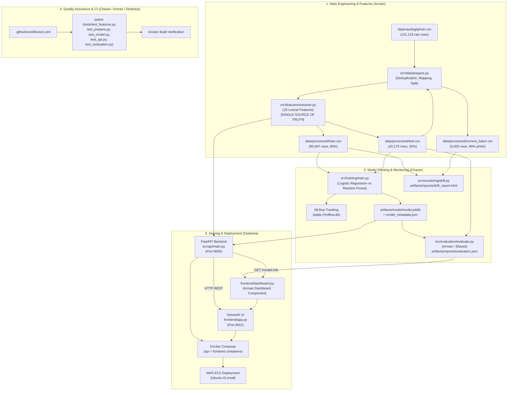

# PhishingShield: System Architecture & Data Flow

PhishingShield is an end-to-end MLOps machine learning system engineered to detect phishing URLs using 16 lexical and structural heuristics. This document specifies the complete system architecture, data pipelines, module boundaries, and contributor ownership.

---

## 1. High-Level Architecture Diagram

---

## 2. Component Ownership & Team Responsibilities

| Contributor | Role | Core Modules & Ownership Responsibilities |
|---|---|---|
| **Arman (Me)** | **Data & ML Engineer** | `src/features/extractor.py` (single source of truth for 16 URL features), `src/data/prepare.py` (cleaning, deduplication, stratified splits), `src/evaluation/evaluate.py` (`compute_metrics` & evaluation report), `frontend/dashboard.py` (model performance UI), `docs/FEATURE_NOTES.md`, architecture documentation, demo script, and integration testing. |
| **Charan** | **MLOps & CI Engineer** | `src/training/train.py` (Logistic Regression baseline, Random Forest primary, XGBoost optional), `src/training/model_io.py`, MLflow experiment tracking, model selection & versioning, `src/monitoring/drift.py` (Evidently data drift), `.github/workflows/ci.yml` (automated testing CI). |
| **Deeksha** | **Backend & Deployment Engineer** | `src/api/main.py` (FastAPI serving: `/`, `/health`, `/predict`, `/model-info`), `src/api/schemas.py`, `frontend/app.py` (main Streamlit detection UI), `Dockerfile`, `docker-compose.yml`, and AWS EC2 deployment. |

---

## 3. Data Flow & Interface Contracts

### 3.1 Feature Extraction Pipeline
* **Input:** Raw URL string (e.g. `https://example.com/login?token=abc`).
* **Normalization:** URLs without schemes are normalized with `http://`.
* **Execution:** `src/features/extractor.py` extracts exactly 16 numeric features:
  1. `url_length`
  2. `has_ip_address`
  3. `dot_count`
  4. `https_flag`
  5. `url_entropy`
  6. `token_count`
  7. `subdomain_count`
  8. `query_param_count`
  9. `tld_length`
  10. `path_length`
  11. `has_hyphen_in_domain`
  12. `number_of_digits`
  13. `tld_popularity`
  14. `suspicious_file_extension`
  15. `domain_name_length`
  16. `percentage_numeric_chars`
* **Invariant:** Both training (`src/training/train.py`) and inference (`src/api/main.py`) call the same `extract_features()` / `extract_batch()` functions. No feature logic is duplicated in the API or frontend.

### 3.2 Model Training & Selection Contract
* Logistic Regression baseline and Random Forest classifiers are trained on `data/processed/train.csv` (80% split).
* Evaluation on `data/processed/test.csv` (20% split) uses `src.evaluation.evaluate.compute_metrics()`.
* **Selection Rule:** Among candidates with phishing false-positive rate $\le 0.10$, select the candidate with highest **F1-score**; break ties on **Recall**. Accuracy alone is never used as the decision criterion.
* The selected model and metadata are serialized to `artifacts/model/model.joblib` and `artifacts/model/model_metadata.json`.

### 3.3 API & UI Integration Contract
* The Streamlit UI communicates with FastAPI strictly over HTTP:
  * `POST /predict`: Sends `{"url": "..."}`, receives prediction, phishing probability, risk level (`LOW`, `MEDIUM`, `HIGH`), and 16 feature values.
  * `GET /model-info`: Returns model name, version, MLflow run ID, metrics, and candidate models.
* `frontend/dashboard.py` renders inside `frontend/app.py`, reading offline test metrics from `artifacts/reports/evaluation.json` and candidate models from `/model-info`.
* If either the API or the evaluation report is temporarily unavailable, friendly status notices are rendered without crashing the application.
